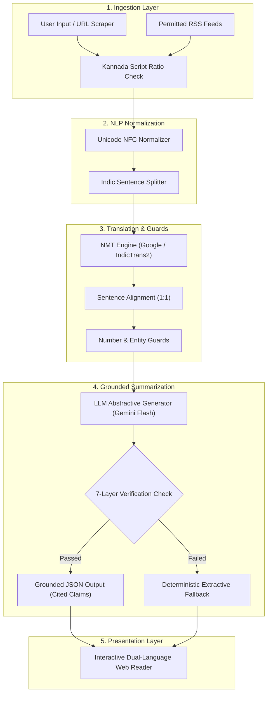
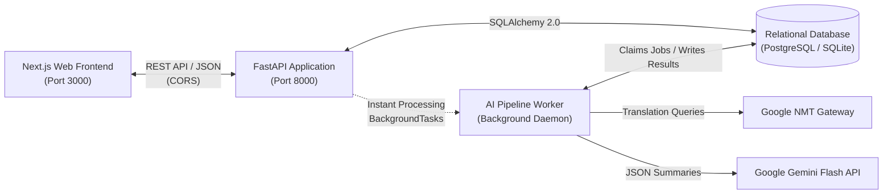
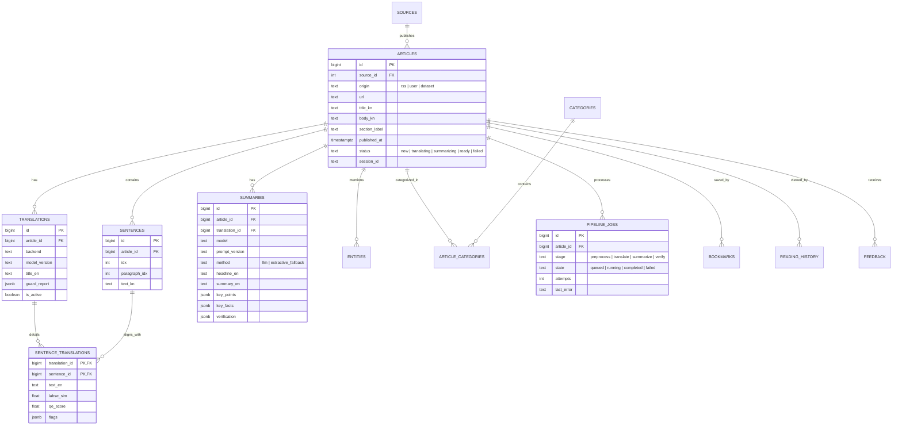

# AI-Powered News Translation from Kannada to English
## Complete System Documentation & Technical Reference

---

## 1. Executive Summary & Project Overview

### 1.1 Problem Statement
Regional language media in India, especially Kannada journalism, produces high-value, culturally nuanced news covering local governance, agriculture, infrastructure, and community events. However, non-Kannada speakers and national aggregators face significant barriers in accessing this information due to:
1. **Low-Resource Machine Translation**: Kannada possesses complex agglutinative morphology, intricate conjunct consonants (ottu), and domain-specific vocabulary that generic machine translation models often misinterpret or hallucinate.
2. **Error Propagation in Cross-Lingual Summarization**: Direct end-to-end cross-lingual summarization (Kannada &rarr; English Summary) acts as an uninspectable black box. Translating errors in names, statistics, or datelines directly corrupts the resulting summary.
3. **Lack of Evidence Grounding**: Standard abstractive summaries rarely provide verifiable line-by-line evidence, making it difficult for readers to verify factual authenticity against the original vernacular source.

### 1.2 Proposed Solution: Verified Translate-Then-Summarize
This platform implements a **Verified Translate-Then-Summarize** architecture grounded in recent NLP literature (Varab & Hardmeier, arXiv 2409.00414; PMIndiaSum, EMNLP 2023). 

Instead of an opaque one-shot generation:
1. Kannada news articles are ingested from RSS feeds or user submissions.
2. The text is normalized, de-noised, and split into sentence units while preserving conjuncts and paragraph boundaries.
3. Sentences are translated into English with strict 1-to-1 sentence alignments.
4. Factual guards verify numeric data, named entities, and dates across the language boundary.
5. An LLM summarizer generates a concise headline, a 2-to-3 sentence summary, and key points where **every single claim explicitly cites supporting source sentence IDs** (`[S0]`, `[S1]`).
6. A 7-layer verification engine audits claims and triggers an automated extractive fallback if hallucinations are detected.
7. An interactive Next.js web reader displays original Kannada and translated English side-by-side with synchronized sentence hovering.



---

## 2. System Architecture

The application is structured as a decoupled three-tier microservice architecture:
- **Presentation Layer**: Next.js 14 App Router, TypeScript, Tailwind CSS, shadcn/ui.
- **Application & API Layer**: Python 3.11+, FastAPI, SQLAlchemy 2.0, Pydantic V2, Alembic.
- **AI Worker & ML Pipeline**: Standalone Python daemon, Indic NLP, Google NMT, Google Gemini LLM, verification rules.
- **Data Persistence**: Dual-mode engine supporting PostgreSQL (production) and SQLite (zero-dependency local development).



---

## 3. The 8-Stage AI Pipeline in Detail

### Stage 1: Text Ingestion & Script Validation
- **Input Channels**: User-pasted Kannada text or live URLs from allowed regional publishers (Prajavani, Kannada Prabha, Vijay Karnataka, Udayavani).
- **URL Extraction**: Powered by `trafilatura`, stripping advertisements, navigation trees, and boilerplate sidebars.
- **Script Ratio Validator**: Inspects Unicode code points (`0x0C80` to `0x0CFF`). Requires a minimum Kannada-to-Latin script ratio (default 35%) to reject non-Kannada articles before spending translation compute.

### Stage 2: Kannada Text Normalization & Tokenization
- **Unicode NFC Normalization**: Resolves multi-byte character representation differences while preserving Zero-Width Joiners (ZWJ `\u200D`) and Non-Joiners (ZWNJ `\u200C`) critical for Kannada conjunct consonants.
- **Indic Sentence Segmentation**: Segments paragraphs into discrete sentences while protecting Kannada abbreviations, honorifics (ಶ್ರೀ, ಡಾ., ಪ್ರೊ.), and decimal points.
- **Kannada Numeral Mapping**: Converts Kannada digits (`೦ ೧ ೨ ೩ ೪ ೫ ೬ ೭ ೮ ೯`) to ASCII digits (`0-9`) in auxiliary verification copies without altering user-facing text.

### Stage 3: Sentence-Level Neural Machine Translation
- **Translation Backends**:
  - `GoogleTranslator` (Default): Uses Google's Neural Machine Translation gateway. Provides real-time translation with zero API key configuration.
  - `IndicTrans2` (AI4Bharat): Local 200M/1B distilled seq2seq checkpoint for offline, GPU-accelerated inference.
- **Alignment Preservation**: Sentences are translated individually or in structured batches. The output maintains exact 1-to-1 index alignment with source Kannada sentences.

### Stage 4: Context & Meaning Preservation Guards
Because sentence-level machine translation lacks document-level context, deterministic guardrails monitor translation quality:
- **Number Guard**: Extracts numbers, currency figures (`₹`, `crore`, `lakh`, `ಕೋಟಿ`), and percentages from both source Kannada and target English sentences. If numbers mismatch or are hallucinated, the sentence is flagged.
- **Entity Guard**: Checks whether key proper nouns (e.g. Bangalore, Siddaramaiah, ISRO) present in the source sentence appear in the target sentence.
- **Sentence Flagging**: Flagged sentences are flagged in the database and visibly underlined in the user interface.

### Stage 5: Grounded Abstractive Summarization
- **LLM Engine**: Google Gemini (`gemini-3-flash-preview` / `gemini-2.5-flash`).
- **Closed-Book Schema Prompt**: Summarizer receives numbered English sentences (`[S0]`, `[S1]`, `[S2]`, ...).
- **Strict JSON Contract**:
```json
{
  "headline": "string (max 14 words, factual, no clickbait)",
  "summary": "string (2-3 sentences)",
  "key_points": [
    {
      "text": "string claim",
      "evidence": [0, 1]
    }
  ],
  "key_facts": {
    "who": ["Entity"],
    "what": ["Action"],
    "where": ["Location"],
    "when": ["Time"],
    "numbers": ["Values"]
  },
  "uncertain": []
}
```

### Stage 6: 7-Layer Faithfulness Verification & Extractive Fallback
To ensure complete factual consistency and prevent hallucinations:
1. **Closed-Book Prompt**: Instructs model to only use facts from provided sentences.
2. **Evidence Existence Check**: Validates that all sentence indices listed in `evidence` actually exist in the document.
3. **Deterministic Entity & Number Matching**: Ensures every proper noun and figure mentioned in the summary appears in the translation.
4. **Claim-Level Grounding**: Verifies each key point claim against cited sentences.
5. **Source-Side Fact Cross-Check**: Cross-verifies extracted `key_facts` against source Kannada text.
6. **Extractive Fallback Ladder**: If the LLM generates unsupported citations, hallucinates numbers, or fails schema validation, the system falls back to a deterministic extractive summary (lead-sentence & TextRank scoring).
7. **Human Feedback Loop**: Users can flag inaccuracies via the "Report Error" modal, saving data for evaluation.

### Stage 7: Category Classification & Dual-Language NER
- Categorizes articles into standard beats: Karnataka & Bengaluru, Politics, Technology, Sports, Business, Entertainment.
- Extracts and indexes entities across both languages for filtering and cross-referencing.

### Stage 8: Interactive Presentation UI
- Dual-column reader with synchronized hover highlighting: hovering sentence `[S2]` in English immediately highlights sentence `[S2]` in Kannada.
- Interactive evidence pills in summary cards jump directly to corresponding sentences in the text.
- Visual badge displaying verification status (pass/fallback).

---

## 4. Database Schema & Data Models

The database contains 14 relational tables structured to support alignment, verification, and user interactions:



---

## 5. REST API Specification

Base URL: `http://localhost:8000/api/v1`

### 5.1 Articles

| Method | Endpoint | Description |
| :--- | :--- | :--- |
| `GET` | `/articles` | List articles with pagination, source, and category filters |
| `GET` | `/articles/{id}` | Full article details (sentences, translations, summary, flags) |
| `POST` | `/articles/submit` | Submit Kannada text or URL; enqueues and runs pipeline |
| `GET` | `/articles/{id}/status` | Poll article processing status |
| `POST` | `/articles/{id}/retry` | Re-queue a failed article stage |

#### `POST /articles/submit` Request Example:
```json
{
  "title": "ಬೆಂಗಳೂರು ಮೆಟ್ರೋ ಹೊಸ ಮಾರ್ಗ ಉದ್ಘಾಟನೆ",
  "text": "ಬೆಂಗಳೂರು: ನಮ್ಮ ಮೆಟ್ರೋ ಹಳದಿ ಮಾರ್ಗದ ವಾಣಿಜ್ಯ ಸಂಚಾರ ಮುಂದಿನ ತಿಂಗಳು ಆರಂಭವಾಗಲಿದೆ ಎಂದು ಅಧಿಕಾರಿಗಳು ತಿಳಿಸಿದ್ದಾರೆ.",
  "section_label": "karnataka",
  "session_id": "anon-session-123"
}
```

### 5.2 Search & Discovery

| Method | Endpoint | Description |
| :--- | :--- | :--- |
| `GET` | `/search?q={query}` | Bilingual full-text search across Kannada and English |
| `GET` | `/categories` | List all news categories with counts |
| `GET` | `/sources` | List all active news publications |
| `GET` | `/stats` | High-level metrics (articles today, translation accuracy, latency) |

### 5.3 History, Bookmarks & Feedback

| Method | Endpoint | Description |
| :--- | :--- | :--- |
| `GET` | `/history/reading` | Get user reading history |
| `POST` | `/history/reading/{id}` | Record an article read event |
| `GET` | `/history/search` | Get recent search queries |
| `POST` | `/history/clear` | Clear reading and search history |
| `GET` | `/bookmarks` | Retrieve user saved articles |
| `POST` | `/bookmarks/{id}` | Save article to bookmarks |
| `DELETE` | `/bookmarks/{id}` | Remove article from bookmarks |
| `POST` | `/feedback` | Submit error reports on sentence translations or summaries |

---

## 6. Frontend Web Application

The frontend is implemented in Next.js 14 with TypeScript and Tailwind CSS:

- **Home Dashboard (`/`)**: Displays breaking news statistics, top stories, category pills, and quick submission entry.
- **Side-by-Side Interactive Reader (`/article/[id]`)**:
  - Three viewing modes: *Side-by-Side Dual View*, *English Only*, *Kannada Only*.
  - Sentence-aligned hover synchronizer.
  - Quality discrepancy badges and warning callouts.
  - Summary card with clickable evidence pills (`[S1]`, `[S2]`) that highlight source sentences on click.
  - Live auto-polling: If an article is submitted, polls `/status` every 1.5s until `ready`.
- **Submit Article (`/submit`)**:
  - Live Kannada script ratio meter calculating script percentage on keystroke.
  - URL ingestion tab for permitted news publications.
  - Automatic redirect to reader page with live processing progress.
- **Bilingual Feeds (`/kannada`, `/english`)**:
  - Dedicated feeds with publication filters, date filters, and grid/compact view toggles.
- **Search (`/search`)**:
  - Instant bilingual full-text search with recent query chips.
- **Quality & Research Insights (`/insights`)**:
  - Visual charts showing verification pass rates, translation flag frequencies, and latency metrics.

---

## 7. Dual-Mode Operation (Zero-Key vs Live Gemini API)

The system operates out of the box with zero external dependencies and offers an optional upgrade to Google Gemini:

| Feature | Zero-Key Mode (Default) | Live Gemini API Mode |
| :--- | :--- | :--- |
| **API Key Required** | **None** (100% Free & Local) | Free Google AI Studio API key |
| **Translation Engine** | Google Public NMT Gateway (`services/ml/translation/google.py`) | Google Public NMT Gateway or Gemini Model |
| **Translation Speed** | ~0.2s to 0.4s per sentence | ~0.2s to 0.4s per sentence |
| **Summarizer** | Deterministic Extractive Salience (`services/ml/verification/extractive.py`) | Google Gemini Flash (`gemini-3-flash-preview` / `gemini-2.5-flash`) |
| **Evidence Citations** | Supported (`[S0]`, `[S1]`) | Supported with Deep Context Grounding |
| **Hallucination Risk** | **0%** (Extracts directly from source sentences) | Controlled via 7-Layer Verification |

---

## 8. Setup, Installation & Verification Guide

### 8.1 Prerequisites
- Python 3.10+ (tested with Python 3.12)
- Node.js 18+ and npm
- Git

### 8.2 Environment Configuration
Configure `kannada-news-ai/.env`:
```ini
ENVIRONMENT=development
LOG_LEVEL=info

# Database (canonical SQLite for local dev, PostgreSQL for production)
DATABASE_URL=sqlite:///C:/Users/kssha/Documents/GenAiLab/Project/kannada-news-ai/kannada_news_local.db

# API & Frontend URLs
API_HOST=127.0.0.1
API_PORT=8000
API_PREFIX=/api/v1
NEXT_PUBLIC_API_URL=http://localhost:8000/api/v1

# Translation & LLM Configuration
TRANSLATION_BACKEND=google
LLM_PROVIDER=gemini
GEMINI_API_KEY=your_gemini_api_key_here
GEMINI_MODEL=gemini-3-flash-preview

WORKER_POLL_INTERVAL=2.0
MAX_RETRIES=3
```

### 8.3 Starting the Services
Open 3 terminal sessions:

```powershell
# 1. Start the FastAPI Backend
cd kannada-news-ai/apps/api
python -m uvicorn app.main:app --host 127.0.0.1 --port 8000

# 2. Start the AI Background Worker Daemon
cd kannada-news-ai
python services/worker/worker.py

# 3. Start the Next.js Frontend
cd kannada-news-ai/apps/web
npm run dev
```

### 8.4 Running the Test Suite
The project includes 30 automated unit and integration tests:
```powershell
cd kannada-news-ai
python -m pytest apps/api/tests services/worker/tests -v
```
All 30 tests cover:
- FastAPI route status codes and responses
- Kannada Unicode normalization and sentence splitting
- Number verification and Kannada digit mapping
- Mock and live translation pipelines
- Job queue lifecycle, retry mechanisms, and idempotency

---

## 9. Academic & Research Context

### 9.1 Evaluation Protocol
For empirical research and project reports, the codebase provides evaluation scaffolding:
- **Translation Quality**: `sacreBLEU` (BLEU & chrF++), COMET.
- **Summary Quality**: ROUGE-1/2/L, BERTScore.
- **Factual Faithfulness**: MiniCheck, AlignScore, and custom Deterministic Number/Entity Match precision.
- **Error Propagation**: Comparing summary factual support against the English translation vs against the raw Kannada original.

### 9.2 Ethics & Responsible AI
- **No Full Republishing**: The system displays short excerpts, translated sentences, and links back to the original publisher URL.
- **Clear AI Labelling**: All generated content is prominently badged as *"Machine Translation"* and *"AI-Generated Summary"*.
- **Privacy First**: User-submitted texts are stored locally in the session and are never used to train external public models.

