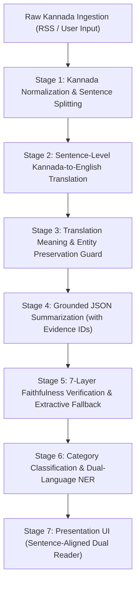

# Technical Architecture & Pipeline Specification

## 1. Pipeline Overview

The system follows a verified **Translate-Then-Summarize** pipeline:

## 2. Component Design

### 2.1 Web Frontend (`apps/web`)
- **Framework**: Next.js 14+ (App Router), TypeScript, Tailwind CSS, shadcn/ui.
- **Key Views**:
  - `/`: Home dashboard with news stats, top stories, category filters, and queue status.
  - `/article/[id]`: Side-by-side interactive reader highlighting sentence alignments on hover, evidence pills, and quality flags.
  - `/submit`: Form for pasting Kannada news text or permitted URLs with live script detection.
  - `/kannada` & `/english`: Filterable language views.
  - `/search`: Full-text search with recent query history.
  - `/insights`: Metrics, translation quality distribution, and latency stats.

### 2.2 Backend API (`apps/api`)
- **Framework**: FastAPI + Pydantic v2 + SQLAlchemy 2.0.
- **Asynchronous Flow**: API requests insert articles and enqueue jobs in `pipeline_jobs` table, returning immediately. Fast response times with no blocking ML inference on the web server.

### 2.3 AI Worker (`services/worker`)
- **Worker Daemon**: Periodically claims pending jobs from `pipeline_jobs` using `SELECT ... FOR UPDATE SKIP LOCKED`.
- **Modularity**: Pluggable backends for Translation (IndicTrans2, Sarvam, LLM, Mock) and Summarization (Gemini, Local Ollama, Mock).

### 2.4 ML Services & Guards (`services/ml`)
- **Kannada Text Processing**: Unicode NFC normalization, ZWJ/ZWNJ preservation, Indic-aware sentence tokenizer.
- **Translation Guards**: Number extractor (handling Kannada numerals ೦-೯, crore, lakh), named entity cross-verification, and semantic cosine similarity.
- **Faithfulness Verification**: Sentence-evidence validation, entailment checking, and automatic fallback to extractive summarization if hallucination is detected.
